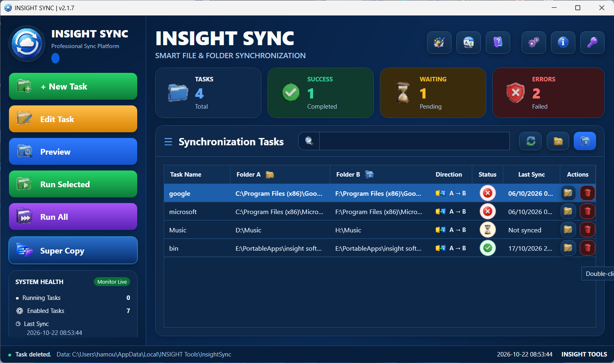
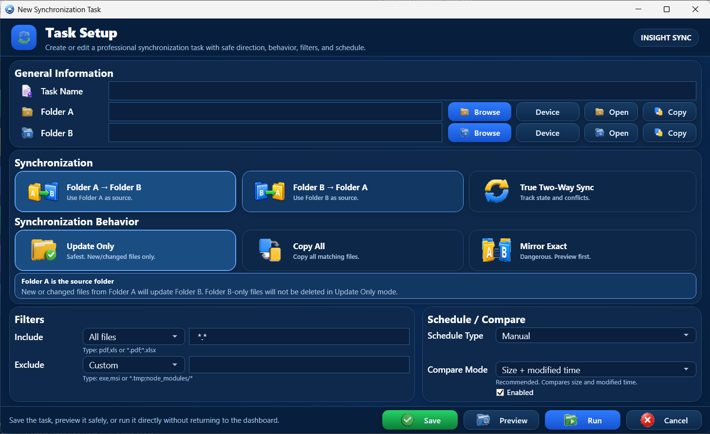
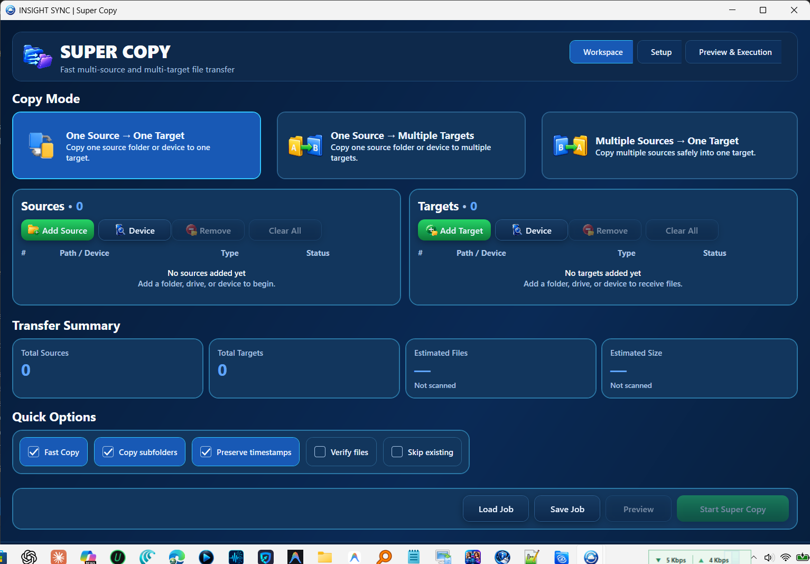

# ⚡ INSIGHT SYNC
### Smart File & Folder Synchronization & High-Speed Multi-Target Transfer
**Version 2.1.7 — Blazing Fast, MTP Mobile Phone Sync & Enterprise Safety**

[-00a4ef.svg?style=for-the-badge&logo=windows)](https://github.com/alarifi/insight-sync)
[-512BD4.svg?style=for-the-badge&logo=dotnet)](https://dotnet.microsoft.com/)

  <b>برنامج احترافي فائق السرعة لمزامنة ونسخ آلاف الملفات بلمح البصر، مع دعم المزامنة بين الأقراص والهاردات الخارجية وهواتف الأندرويد والكمبيوتر.</b> 
  A high-performance file synchronization and bulk data transfer platform for Windows. Features multi-source & multi-target Super Copy, connected mobile phone (MTP) sync, True Two-Way synchronization, and granular preview verification.

---

## 📸 Interface Screenshots | واجهات البرنامج

### 📊 1. Synchronization Tasks Dashboard

<i>لوحة التحكم الرئيسية: مراقبة حالة المهام المكتملة، قيد الانتظار، الأخطاء، وتشغيل كل المهام بنقرة واحدة.</i>

 

### ⚙️ 2. Task Setup & Advanced Direction Rules

<i>إعداد المهام: دعم المزامنة باتجاهين (Two-Way)، التحديث الذكي (Update Only)، المرآة المطابقة (Mirror Exact)، والفلاتر المتقدمة.</i>

 

### 🚀 3. Super Copy — Multi-Source & Multi-Target Engine

<i>محرك النسخ الخارق: نقل من مصدر لعدة وجهات في نفس الوقت (مثل هارد وفلاشة معاً) أو تجميع مصادر متعددة لوجهة واحدة.</i>

---

## 🌟 Superpowers & Features | أهم المميزات التنافسية

### 🇸🇦 المميزات الحصرية (بالعربية)

1. 🚀 **محرك النسخ الخارق (Super Copy Turbo Engine)**:
   - نسخ ونقل آلاف الملفات الضخمة بسرعات قياسية تفوق أداء ناسخ الويندوز التقليدي.
   - **من مصدر واحد إلى عدة وجهات (One Source -> Multiple Targets)**: إمكانية أخذ نسخة احتياطية على قرص خارجي وفلاشة USB في نفس اللحظة بنقرة واحدة.
   - **من عدة مصادر لوجهة واحدة (Multiple Sources -> One Target)**: تجميع مجلدات متفرقة إلى مجلد مركزي واحد بكل سهولة.
   - خيارات احترافية: التحقق من صحة الملفات المنقولة (`Verify files`)، تخطي الملفات الموجودة (`Skip existing`)، والحفاظ على التواريخ الأصلية (`Preserve timestamps`).

2. 📱 **المزامنة الحصرية مع الهواتف الذكية (Phone & Android MTP Sync)**:
   - يدعم بروتوكول **MTP (MediaDevices)** المدمج لنقل ومزامنة الصور والفيديوهات والملفات مباشرة بين **هواتف الأندرويد والكمبيوتر** عبر كابل USB مباشرة عبر زر **Device** دون الحاجة لتثبيت تطبيقات وسيطة على الهاتف!
   - المزامنة السلسة بين الأقراص الداخلية (C/D/E)، الهاردات الخارجية (External HDDs / SSDs)، ووحدات التخزين الشبكية وفلاشات USB.

3. 🔄 **أوضاع مزامنة ذكية تناسب كافة الاحتياجات**:
   - **مزامنة باتجاهين حقيقية (True Two-Way Sync)**: تتبع ذكي للملفات المحدثة في كلا الجانبين وحل التعارضات تلقائياً.
   - **التحديث فقط (Update Only - Safest)**: نقل الملفات الجديدة والمعدلة فقط وهو الوضع الأكثر أماناً لحماية الملفات الأصلية.
   - **المرآة المطابقة (Mirror Exact)**: جعل المجلد الهدف نسخة طبق الأصل من المصدر مع التنبيه الذكي.
   - **نسخ الكل (Copy All)**: نسخ شامل لكافة الملفات المستهدفة.

4. 🛡️ **الأمان والتحقق المسبق (Zero-Risk Preview)**:
   - ميزة **Preview** الاستباقية لمعاينة قائمة الملفات وحجمها والإجراءات التي ستتم قبل نقل أي ملف، لحماية بياناتك من أي خطأ غير مقصود.
   - فلاتر متقدمة للتضمين والاستثناء (مثل استثناء صيغ معينة `*.tmp` أو مجلدات التطوير `node_modules`).

5. ⚡ **أداء خفيف وواجهة عصرية**:
   - واجهة مستخدم مبنية بـ **WPF & C# (.NET 8)** مع وضع ليلي فاخر ومؤشرات صحة النظام (System Health Monitor Live).
   - حجم البرنامج خفيف جداً (~4.8 ميجابايت للمثبت و ~3.3 ميجابايت للمحمولة).

---

### 🇬🇧 English Overview & Key Features

- **Multi-Source & Multi-Target Super Copy**: Blazing-fast parallel file pipeline allowing 1-to-N or N-to-1 backup flows simultaneously.
- **Direct Smartphone MTP Integration**: Seamlessly sync and backup photos, music, and documents to/from Android and connected mobile devices via native `MediaDevices` protocol.
- **True Two-Way Sync Engine**: Real-time state tracking and conflict detection across local drives and external disks.
- **Smart Synchronization Policies**: Flexible modes including Update Only (safest), Copy All, and Exact Mirror.
- **Comprehensive Pre-Execution Preview**: Inspect every pending copy, update, or sync action before a single byte is touched.
- **Fine-Grained Filtering**: Glob pattern filters for file inclusions and exclusions (e.g. `*.pdf`, `node_modules/*`, `*.tmp`).
- **Engineered on .NET 8 & WPF**: Ultra-lightweight memory footprint with zero cloud dependencies and 100% offline security.

---

## 💾 Downloads | روابط التحميل

| الإصدار / الحزمة | نوع الملف | الحجم | الوصف | التحميل المباشر |
| :--- | :---: | :---: | :--- | :---: |
| **INSIGHT SYNC Setup v2.1.7** | `.exe` (Installer) | ~4.8 MB | برنامج التثبيت الرسمي لنظام ويندوز مع أيقونات سطح المكتب وقائمة ابدأ | [⬇️ تحميل التثبيت الرسمي (Setup.exe)](https://github.com/alarifi/insight-sync/releases/download/v2.1.7/INSIGHT_SYNC_Setup_v2.1.7.exe) |
| **INSIGHT SYNC Portable v2.1.7** | `.zip` (Portable) | ~3.3 MB | نسخة محمولة جاهزة للتشغيل الفوري من أي مجلد أو فلاشة USB بدون تثبيت | [⬇️ تحميل النسخة المحمولة (Portable.zip)](https://github.com/alarifi/insight-sync/releases/download/v2.1.7/INSIGHT_SYNC_Portable_v2.1.7.zip) |

---

## 💻 System Requirements | متطلبات التشغيل

- **Operating System**: Windows 11 / Windows 10 / Windows 8.1 (64-bit).
- **Runtime**: .NET Desktop Runtime 8.0 (x64).
- **RAM**: 512 MB minimum.
- **Storage**: ~25 MB free space.
- **Connectivity**: USB for external storage drives & smartphone MTP sync.

---

## 🏢 Publisher & Support | المطور والدعم الفني

Developed and published with pride by **INSIGHT Tools**.
- **Official Website**: [https://www.insight-ye.com](https://www.insight-ye.com)
- **Repository**: [alarifi/insight-sync](https://github.com/alarifi/insight-sync)
- **Feedback & Issues**: Please report any bugs or submit feature suggestions via GitHub Issues.

---

  Copyright © 2026 INSIGHT Tools. All rights reserved.

---

## ⭐ Rate This App | قيّم تجربتك

Have you tried **insight-sync**? Please share an honest 1–5 star rating and suggestions to help us improve.

هل جربت البرنامج؟ شارك تقييمك الصادق من 1 إلى 5 نجوم وملاحظاتك لتساعدنا على تطويره.

**[⭐ Rate this app / قيّم البرنامج](https://github.com/alarifi/insight-sync/issues/new?template=rate-your-experience.yml)**

> GitHub sign-in is required. Reviews posted as Issues are public; do not share private information. The GitHub repository Star button is a separate way to show support, not a 1–5 rating.
